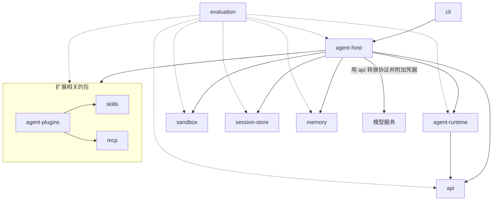
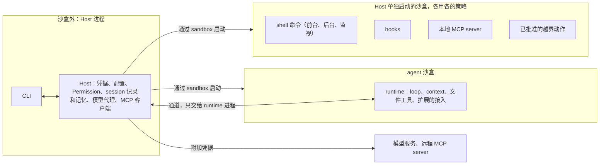

# Coding Agent 总体设计

日期：2026-11-06（Asia/Shanghai）  
状态：架构规划，供搭建 monorepo、实现和验收使用。

Osprey Code 是一个运行在用户电脑上、通过 CLI 使用的 coding agent（名字见[名字](#名字)）。它由十一个包组成，每个包都按对外发布的 SDK 标准来做（见 [SDK 标准](#sdk-标准)），可以单独给其他项目使用。

文档里写出的目录名、接口名和字段名就是实现时用的名字，实现中要改名先改文档。各文档反复出现的词按下文[术语](#术语)理解。外部项目、规范和版本号的信息核对于 2026-11-06。

第一次阅读按这个顺序：[十一个包](#十一个包)、[运行时的部署](#运行时的部署)、[一次任务的流程](#一次任务的流程)，再按需要读 `docs/packages/` 下各包的文档。每个阶段交付哪些功能，见[实施计划](roadmap.md)。

## 术语

| 术语 | 含义 |
|---|---|
| 包 | `packages/` 下的十一个 npm 包 |
| 仓库 | agent 处理的用户项目，例如"仓库自带的配置" |
| Host | 沙盒外的本地后端，首版和 CLI 在同一个进程里。持有凭据、配置、权限决定、session 记录和记忆，启动和管理 agent 进程 |
| agent 进程 | Host 通过 `sandbox` 启动、在 agent 沙盒里运行的进程，每个打开的 session 一个。里面运行的代码称为 runtime |
| 命令沙盒 | Host 为每条 shell 命令（前台、后台和监视）单独启动的沙盒，命令不在 agent 沙盒里运行。hooks、本地 MCP server 和批准的越界动作也各自在 Host 单独启动的沙盒里运行（见 sandbox 的[命令的执行](packages/sandbox.md#命令的执行)） |
| 辅助进程 | `sandbox` 包启动的子进程，加载 sandbox-runtime，为一组沙盒生成启动命令并运行它们的网络代理（见 sandbox 的[沙盒后端](packages/sandbox.md#沙盒后端)） |
| 通道 | Host 和 agent 进程之间唯一的连接；接口由 `agent-runtime` 定义、Host 实现（见 agent-runtime 的[通道](packages/agent-runtime.md#通道)） |
| Permission | `sandbox` 包里在 Host 一侧做权限判断的模块：审批策略、权限规则、越界申请和批准记录 |
| 权限规则 | 对命令、域名和 MCP 工具写明放行、询问或禁止的规则：内置的随 `sandbox` 包发布，用户和仓库的写在 `rules/*.toml` 里（见 sandbox 的[规则](packages/sandbox.md#规则)） |
| 规则文件 | 给模型读的指令文件，如 `AGENTS.md`、`CLAUDE.md`，分用户级和仓库里的两种；只是模型的输入，不改变权限 |
| 工作区 | 启动 Host 时的当前目录，`workspace-write` 下可写的就是它 |
| 越界 | 动作超出当前沙盒模式允许的范围；模型申请、用户批准后，由 Host 在新的受限进程里执行（见 sandbox 的[越界申请](packages/sandbox.md#越界申请)） |
| 扩展、插件 | 扩展是 MCP、Skills、插件和 hooks 四种机制的统称；插件专指 Agent Plugins 格式的安装包 |
| session | 可以包含多个 task 的会话。打开期间有一个 agent 进程，后台命令也属于它；用户退出 CLI 时关闭，Host 结束其中的全部进程；关闭后可以恢复 |
| task | 用户要完成的一件事，由 session 空闲时的一次输入开始 |
| run | task 的一次执行；恢复、回退和分叉都开始新的 run |
| 一轮 | 一次模型请求加上它返回的全部工具调用 |
| tool call | 一次工具调用；执行前向 Host 登记，由 Host 分配 `tool_call_id` |
| steering、follow-up | task 运行中用户的两种输入：steering 并入当前 task；follow-up 排队，当前 task 完成后作为新的 task 开始（见 agent-runtime 的[运行中的用户输入](packages/agent-runtime.md#运行中的用户输入)） |
| 后台命令 | 放到后台运行的命令，属于 session，跨 task 保留（见 agent-runtime 的[后台命令](packages/agent-runtime.md#后台命令)） |
| session 记录 | Host 通过 `session-store` 保存的只追加事件；恢复、回退和评测都依据它 |
| 恢复 | 中断（退出、崩溃）之后按 session 记录接着执行（见 agent-host 的[中断后的恢复](packages/agent-host.md#中断后的恢复)） |
| 快照 | Host 在工具调用执行前后保存的工作区内容，只用于撤销，不影响权限 |
| 检查点 | 每次用户输入时的还原点：session 记录里的位置加对应的快照 |
| 回退、分叉 | 回退把会话的当前位置移回某次用户输入之前；分叉从某个位置开出一个新的 session（见 session-store 的[会话的分支和回退](packages/session-store.md#会话的分支和回退)） |
| 内部协议 | `api` 包定义的模型请求格式，其他包只用它 |
| 模型代理 | Host 里转发模型请求的部分：检查模型和预算，用 `api` 转换协议并附加凭据 |

## 十一个包

| 包 | 负责什么 | 实现方式 |
|---|---|---|
| `sandbox` | 判断 agent 能不能做某件事，并由操作系统限制它实际能做的事 | 适配 anthropics/sandbox-runtime |
| `session-store` | 保存 session 记录：事件、会话树、检查点索引和按引用保存的大内容 | 自研，用 Node 自带的 `node:sqlite` |
| `memory` | 从 session 记录里提炼长期记忆，按 project 和 user 两种范围检索、纠正和删除 | 自研 |
| `api` | 定义模型请求的内部协议，并在它和各家协议之间转换 | 自研，首批支持 `openai.chat`、`openai.responses`、`anthropic.messages` |
| `skills` | 按 Agent Skills 规范解析、校验和查找 skills | 自研，只实现规范本身 |
| `mcp` | MCP 客户端：协议版本、传输方式（stdio、Streamable HTTP）和 OAuth 授权 | 封装 MCP 官方 TypeScript SDK |
| `agent-plugins` | 按 Agent Plugins 1.0.0 读取和校验插件目录，找出其中的 skills 和 MCP server，解析 `mcp.json` | 自研，只实现规范本身 |
| `agent-runtime` | 在沙盒里调用模型和工具把任务做完：loop、工具、扩展的接入，以及它和 Host 之间的通道接口 | 自研 |
| `agent-host` | 本地后端：管理 session 和 task，持有凭据和配置，管理扩展，把其他包组装起来 | 自研，供 `cli` 和评测嵌入 |
| `cli` | 命令行界面：子命令、交互界面、非交互运行和对外的事件流 | 交互界面用 pi 的终端界面库 |
| `evaluation` | 检查各部分单独和组合起来是否真的有效 | 自研，不发布；分 agent 能力评测和 sandbox 专项评测两类 |

各包的设计见 `docs/packages/` 下的同名文档；`cli` 只是 Host 的一层界面，设计写在 agent-host 的 [CLI](packages/agent-host.md#cli) 一节。

两项能力是硬性要求：

- **兼容多家模型协议**：各家协议都和 `api` 的内部协议互转，其他包只用内部协议，换模型服务不改其他包。
- **扩展**：MCP、Skills、插件按公开规范实现、不自造变体，其他 agent 生态里按这些规范发布的扩展可以直接使用；各家自有格式的插件（如 Claude Code 的）不能直接加载。Hooks 由本项目自行设计（见 agent-host 的 [Hooks](packages/agent-host.md#hooks)）。扩展的启用和信任见 agent-host 的[扩展的管理和信任](packages/agent-host.md#扩展的管理和信任)。

## 依赖方向



实线是依赖关系，虚线是评测关系。

- `sandbox`、`session-store`、`memory`、`api`、`skills` 和 `mcp` 不依赖本项目的其他包。`memory` 需要调用模型、读取 session 记录或检测密钥时，由调用方传入发起调用的函数、session 的内容或检测函数。
- `agent-plugins` 只依赖 `skills` 和 `mcp`：插件里的 skills 交给 `skills` 解析，MCP server 声明转成 `mcp` 的 server 定义。
- `agent-runtime` 只依赖 `api`，其他能力（工具调用的登记和权限、MCP 工具、skill 的内容、session 记录、记忆）都经通道向 Host 请求。Host 先把插件展开成 skills 和 MCP 工具，再交给 runtime。
- `agent-host` 依赖以上全部包；它依赖 `agent-runtime` 是为了实现通道接口、找到 agent 进程的入口，runtime 本身在沙盒里的另一个进程中运行。
- `cli` 只依赖 `agent-host` 和终端界面库，评测和其他嵌入 Host 的程序不会装上界面的依赖。
- `evaluation` 只通过公开接口调用其他包，产品代码不依赖它。
- 配置：每个包导出自己那部分配置的类型和校验（如 `sandbox` 的权限配置和规则、`api` 的模型清单条目），Host 的 `config/` 只负责读取、分层合并和执行仓库配置的限制。
- 标识（user、project、session、task、run、tool call 等）都由 Host 生成（见 agent-host 的[标识](packages/agent-host.md#标识)），其他包把它们当作普通字符串。

事件的格式和写入：

| 内容 | 格式由谁定义 | 谁写入 session 记录 |
|---|---|---|
| 事件的公共字段和存储格式 | `session-store` | — |
| 模型的消息（流式增量只用于实时显示，不存储） | `api` 的内部协议 | Host 的模型代理 |
| 每条消息在目标协议里的原文 | `agent-host` | Host 的模型代理 |
| 工具调用事件（`tool_call.started`、`tool_call.completed`） | `agent-runtime` 的 `contracts/` | Host |
| runtime 自己的事件（上下文压缩、用户输入插入的位置、作废） | `agent-runtime` | runtime 经通道上报，Host 核实来源后写入 |
| task、批准、命令、hooks 和进程事件 | `agent-host` | Host |
| CLI 的对外事件、hooks 的输入 | `agent-host`，各有版本，和存储格式分开 | 不存储 |

## 运行时的部署

agent 的执行进程（loop、工具、扩展和它们启动的子进程）始终运行在系统沙盒里；凭据、配置、权限决定、session 记录和记忆都放在沙盒外的 Host 中。沙盒内的代码，包括 runtime 自己，都按可能被攻破处理：真正起限制作用的是系统沙盒和沙盒外的 Permission，沙盒内的检查只服务于交互。评测环境不启用沙盒，见 [evaluation](packages/evaluation.md)。



| 位置 | 运行什么 | 限制 |
|---|---|---|
| 沙盒外：Host | CLI、凭据、配置、Permission 和批准记录、扩展的信任记录、session 记录和记忆、模型代理、MCP 客户端、进程管理 | 任何沙盒都不能读写这些数据 |
| 沙盒外：辅助进程 | `sandbox` 包启动的子进程：加载 sandbox-runtime、生成沙盒的启动命令、运行网络代理（见 sandbox 的[辅助进程](packages/sandbox.md#辅助进程)） | 由 Host 启动，只和 Host 通信；Host 进程本身不加载 sandbox-runtime |
| agent 沙盒 | runtime 的 loop、上下文处理、文件工具和扩展的接入 | 策略在 agent 进程启动时固定，按沙盒模式读写，不能联网 |
| Host 单独启动的沙盒 | shell 命令、hooks、本地 MCP server、批准的越界动作，以及它们启动的子进程 | 每个按启动时的策略（越界时按批准的权限）单独启动，输出经 Host 交回 runtime |
| 通道 | 两者之间唯一的接口（见 agent-runtime 的[通道](packages/agent-runtime.md#通道)） | Host 只执行经过 Permission 批准、并在新沙盒里运行的动作，没有在沙盒外执行命令的入口。请求属于哪个 session 由通道决定，当前的 task 和 run 由 Host 的记录决定，不采信请求里填写的标识 |

- 沙盒内只运行 `agent-runtime` 和它用到的 `api` 内部协议；其余的包只在 Host 一侧使用，所以信任边界上只有通道这一份接口要检查。
- loop 也放在沙盒里，不只给命令套沙盒：runtime 处理的都是不可信内容，它被攻破时也只有沙盒内的权限。runtime 需要的配置由 Host 读取后交给它。

## 一次任务的流程

下面按顺序串起一次任务经过的各个部分，细节见链接的各包文档。

1. **启动**：用户在某个目录运行 CLI。Host 把这个目录定为工作区，判断项目身份，读取用户级和项目级配置，确定沙盒模式和审批策略，取得工作区锁，运行会话开始的 hooks，启动本地 MCP server、连接远程 MCP server 并等它们就绪（P2），再通过 `sandbox` 启动 agent 进程。agent 进程的第一条请求 `initialize` 带 `agent-runtime` 的包版本，响应就是 runtime 需要的配置（见 agent-host 的 [session 的打开和关闭](packages/agent-host.md#session-的打开和关闭)）。
2. **开始 task**：用户提交输入，Host 生成 task 和 run，把输入经通道交给 runtime。
3. **请求模型**：runtime 用内部协议组织请求，经通道发给 Host。Host 的模型代理检查模型和预算，用 `api` 转换成目标协议、附加凭据后发出，再把流式响应转换回内部事件交给 runtime，并记录用量（见 api 的[在系统中的位置](packages/api.md#在系统中的位置)）。
4. **执行工具**：模型要调用工具时，runtime 先向 Host 登记，Host 分配 `tool_call_id`，然后按固定顺序处理：工具调用前 hooks → Permission → 快照（P3 起）→ 执行（见 agent-host 的[工具调用的处理](packages/agent-host.md#工具调用的处理)）。
   - Permission 按权限规则、内置的危险命令判断和模型的越界申请决定直接执行、询问用户或拒绝（见 sandbox 的[审批策略](packages/sandbox.md#审批策略)和[规则](packages/sandbox.md#规则)）。
   - shell 命令由 Host 按当前策略（越界时按批准的权限）单独启动沙盒执行，输出经通道流式交回；文件工具由 runtime 在 agent 沙盒里执行，写到可写范围之外的改动由 Host 另起受限进程写入。
   - 命令访问还没放行的域名时，由 Host 一侧的网络代理拦下，按 sandbox 的[网络访问的审批](packages/sandbox.md#网络访问的审批)处理。
   - MCP 工具由 Host 检查是否获准后作为 MCP 客户端代为调用，默认每次询问（P2）。
5. **继续或结束**：runtime 重复第 3、4 步，直到模型给出最终回复、超出预算或被取消。期间用户可以发送 steering，或者把 follow-up 排进列表；task 结束后，follow-up 和后台命令的通知按 agent-host 的 [task 的开始、结束和取消](packages/agent-host.md#task-的开始结束和取消)开始新的 task。
6. **退出**：用户退出 CLI 时 session 关闭，Host 按固定顺序收尾：会话结束的 hooks → 结束这个 session 的全部沙盒 → 保存事件 → 释放工作区锁。之后可以恢复这个 session（P3，见 agent-host 的[中断后的恢复](packages/agent-host.md#中断后的恢复)）。

## 所有包都遵守的规则

- 模型读到的内容，包括仓库文件、网页、工具输出、扩展内容和历史记忆，都不能改变权限。只有用户的批准和 Host 的配置能改变权限。
- 身份和可访问范围由 Host 提供，不接受模型或沙盒内代码自己填写的 user 或 project ID。
- 一次批准只对应一个具体动作（或同一资源上的同类动作）、一个任务和一个有效期，执行前再检查一次。需要长期生效的放行，由用户写进仓库以外的配置，成为权限规则。历史记录可以用来恢复和核对，但不能产生新的授权。
- 沙盒后端做不到要求的隔离时，报告不支持并停止执行，不降级运行。
- 关闭沙盒（沙盒模式 `danger-full-access`）必须在启动时显式指定，并在输出和记录中标明。仓库里的配置和模型的请求都不能关闭沙盒。
- Host 在沙盒外读取仓库里的文件（项目配置、权限规则文件、`.git` 下的文件）时，不跟随指向工作区之外的符号链接，否则仓库可以借链接让 Host 读到 `~/.ssh` 这类文件；解析出错时，错误信息不回显文件内容。
- Host 只为模型服务、MCP server、用户批准的网络访问和用户发起的操作（登录、安装扩展）联网：不发送遥测和错误报告，不检查新版本，不拉取远程的模型清单，发给模型服务的请求不附带统计或归属用的标头。错误只写进 Host 根目录下 `data/logs/` 里的日志，由用户自己导出。没有这类流量，所以也不设开关。Linux 评测容器用只放行模型服务域名的网络策略检查 Host 没有别的连接。

## 工程约定

### 代码组织

十一个包放在同一个 git 仓库里，组织方式照 [pi](https://github.com/earendil-works/pi)（commit `d7a988d`）：

```text
coding-agent/
  package.json          根配置：private，用 npm workspaces 管理各包，统一的 build、check、test、版本和发布脚本
  tsconfig.base.json    各包共用的 TypeScript 配置
  tsconfig.json         把包名映射到各包的 src，跨包类型检查不用先构建
  packages/
    sandbox/            对外发布
    session-store/      对外发布
    memory/             对外发布
    api/                对外发布
    skills/             对外发布
    mcp/                对外发布
    agent-plugins/      对外发布
    agent-runtime/      对外发布
    agent-host/         对外发布：Host 的 SDK
    cli/                对外发布：CLI 命令和交互界面，打包成几个入口文件
    evaluation/         private，不发布，同样按 SDK 标准来做
  scripts/              版本同步、依赖检查和发布脚本
  docs/                 本文和 packages/ 下各包的设计文档
  AGENTS.md             文件地图和编码规则
```

- 每个包有自己的 `package.json`、`src/`、`test/`、`README.md` 和 `CHANGELOG.md`；设计文档列出的模块是该包 `src/` 下的目录。
- 公开接口只由 `package.json` 的 `exports` 声明，其他包只能经这些入口引用。包之间的依赖写在各自的 `package.json` 里，检查脚本确认每个包只引用声明过的依赖，[依赖方向](#依赖方向)由此自动检查。
- 所有发布的包用同一个版本号，一起升级、一起发布，包之间的依赖固定到这个确切版本。
- 根目录的 `npm run check` 做格式、lint、类型检查和依赖检查，`npm test` 运行各包的测试，`npm run check:pack` 做打包后在 monorepo 之外的安装检查并运行各包 README 里的示例，`npm run version:set -- <版本>` 同步所有包的版本。
- 每个包单独维护 CHANGELOG，未发布的改动记在 `## [Unreleased]` 下。

### SDK 标准

每个包都按对外发布的 SDK 来做，可以脱离本项目单独使用；`evaluation` 不发布，也照此要求。

- **公开接口**：只通过 `exports` 对外，并随包发布类型声明。导出的函数、类型和错误类型都是公开接口。
- **不依赖隐含的环境**：不使用进程级的全局状态，存储位置、通道、日志等依赖由调用方显式传入。上游库自带的进程级状态（如 sandbox-runtime 的单例和它注册的信号处理函数）放进包自己启动的子进程里，不出现在公开接口中。
- **文档和示例**：README 说明用途、安装方法、最小可运行示例、主要接口、平台要求和许可证；公开接口都有注释。
- **版本和兼容**：遵循[版本号](#版本号)的约定。破坏性改动写进 CHANGELOG 的 `### Breaking Changes` 并给出迁移方法；存储格式和事件格式变化时提供数据迁移。
- **依赖**：新增运行时依赖要有理由，固定到确切版本，引入前核对许可证；安装时不需要生命周期脚本；不引入 AGPL 依赖。
- **测试**：除包内的单元测试，还要有只通过公开接口的测试。发布前把包打包，在 monorepo 之外的干净项目里安装并运行示例。

### 语言和运行环境

用 TypeScript（Node.js），和 pi、sandbox-runtime 一致。

- Node 最低 24.15.0，`engines.node` 写 `^24.15.0 || >=26.0.0`（25 是不进入 LTS 的奇数版本）。开发和 CI 以 Node 26 LTS（26.13.0）为主，CI 同时在 24.15.0 上运行。下限取 24.15.0：`node:sqlite` 从这个版本起为 Release candidate、不再输出实验性警告。不选 22：它在 2027-04-30 结束维护。
- Host 启动时检查 `process.versions.node`，不满足就报错退出：`engines` 只产生警告，仓库里的 `.nvmrc` 之类的文件也能让版本管理器换掉 Node。
- Node 的 `fetch` 默认不使用 `HTTPS_PROXY`，开启代理会改变整个进程的状态，所以由进程的拥有者开启：CLI 入口在打开 session 之前，按配置的 `proxy` 或启动环境里的 `HTTPS_PROXY` 调用 `http.setGlobalProxyFromEnv()`；`agent-host` 的 SDK 不改全局状态，嵌入它的程序自己开启代理，或经 SDK 传入带代理的 `fetch`。评测容器要求经代理访问模型服务时就是这种情况。
- CLI 只以 npm 包分发：`cli` 包用 esbuild 把自己和全部 JS 依赖打包（照 pi v1.5.0），用 `npm install -g --ignore-scripts` 安装。按进程入口打成几个文件：CLI 本身、agent-runtime 的各个角色（agent 进程、apply-edits）和 `sandbox` 的辅助进程，Host 用 `process.execPath` 运行对应的文件。全局安装不使用包里的 lockfile，打包也就是在构建时固定传递依赖的办法；单独使用 SDK 包的项目由自己的 lockfile 固定，Host 从 `agent-runtime` 和 `sandbox` 的 `exports` 找到这些入口。
- sandbox-runtime 的 `vendor/` 二进制随 `cli` 包发布。适配层确认 `apply-seccomp` 等文件存在后显式传入路径，不存在就停止，不让 sandbox-runtime 去 `npm root -g` 这类用户可写的位置找。
- 不做单文件可执行程序：Node 26 的单文件程序还在开发阶段；Bun 编译的产物默认读取当前目录的 `.env` 和 `bunfig.toml`，等于让仓库文件改 Host 的环境。

### 工具链

照 pi 的组织，几处按本项目的要求调整。

- npm workspaces 加根目录的 `package-lock.json`；`.npmrc` 设 `save-exact=true`、`min-release-age=7`（只安装发布满 7 天的版本）和 `registry=https://registry.npmjs.org/`（lockfile 和发布都只走官方 registry，不受开发者本机镜像设置的影响）；CI 用 `npm ci --ignore-scripts`，GitHub Actions 引用的 Action 固定到 commit SHA；不用 husky 这类需要 `prepare` 脚本的工具。
- 各包用 TypeScript 7.0.2 的 `tsc` 编译，它能为各包生成 `.d.ts`，跨包的类型引用在声明里写成包名；只发布 ESM，`exports` 只写 `types` 和 `import`。跨包类型检查用 `tsconfig.json` 的 `paths`，测试用 vitest 的 alias，发布的 `exports` 不指向没有发布的源码。
- `cli` 包另用 esbuild 0.28.2 打包。
- 测试用 vitest 5.0.5。
- Node 的类型声明用 `@types/node` 24.13.6：它是不超过最低支持版本 24.15 的最新一版，类型里不会出现 24.15 没有的接口。
- lint 和格式化用 Biome 2.6.4，开启 `noUndeclaredDependencies`，只允许测试和脚本使用 devDependencies；依赖声明的检查交给它，因为 TS 7 的编程接口还在 `typescript/unstable/*` 下。Biome 不处理 Markdown，文档由人排版。
- 其余检查写成不依赖第三方库的 Node 脚本（用 TypeScript 写，由 Node 直接运行）：直接依赖写确切版本，各包版本一致，包之间的引用符合[依赖方向](#依赖方向)，`npm sbom` 列出的许可证都在白名单内（见[许可证](#许可证)），打包后能在 monorepo 之外安装。
- 通道消息的 schema 用 `typebox`（见 agent-runtime 的[通道](packages/agent-runtime.md#通道)）。
- 发布由 `v<版本>` 形式的 tag 触发，tag 和各包的版本不一致时停止，不用 changesets。CI 用 npm 的 trusted publishing（OIDC，自动生成 provenance）在每个公开包的目录里执行 `npm stage publish --ignore-scripts`（它不认识 workspaces），维护者用 2FA 批准后版本才公开；trusted publisher 用 `npm trust` 只开 `--allow-stage-publish`，npm 上的包设为要求 2FA、禁止令牌发布。每个包第一次发布由维护者在本机用 `npm publish --access public` 完成（`npm stage` 要求包已经存在），之后再为它配置 trusted publisher。Node 26 自带的 npm 11.20.0 满足 staged publishing 的要求（11.15.0 以上），CI 不另装 npm。

### 支持的平台

先跑通开发机所用的 macOS。评测在 Linux 容器里运行，所以 agent 本身（不启用沙盒）从 P1 起也要能在 Linux 上运行。

- **macOS**：只支持 Apple Silicon，最低 macOS 15，CI 在 GitHub 托管的 `macos-15` 和 `macos-26`（arm64）上用真实沙盒测试。不支持 Intel Mac：Node 26 已把 macOS x64 降为 Tier 2。
- **Linux 上的 agent 本身**（不启用沙盒）：从 P1 起支持 x64 和 arm64 的 glibc 发行版，要求 glibc 2.28 以上；用 Node 26 时还要有 `libatomic1`。DeepSWE 的基础镜像 mars-base（Debian 12）满足这两项，但预装的 Node 24.12.0 低于下限，评测的安装步骤自带固定版本的 Node。不支持 musl（Alpine）。
- **Linux 沙盒**：适配层在启动时按条件检查，不按发行版名判断：bubblewrap 0.8.0 以上且不是 setuid 安装，x64 或 arm64，非特权 user namespace 里能拿到能力，没有加载 `bwrap-userns-restrict`；任何一项不满足就报告不支持并停止。
  - 首个列入支持的发行版是 Ubuntu 24.04（自带 bubblewrap 0.9.0）：安装说明按它的发行说明给出允许 `bwrap` 使用 `userns` 的 AppArmor 配置，由用户以 root 安装，不整体关闭 `kernel.apparmor_restrict_unprivileged_userns`。
  - Ubuntu 22.04（bubblewrap 0.6.1）不支持。Ubuntu 26.04 的 `apparmor` 包自带 `bwrap-userns-restrict`，在 sandbox-runtime issue #429 解决前不支持。
  - Debian 12、13 和 Fedora 43 起的 bubblewrap 满足版本要求，启动检查通过就能运行，但 CI 不测。
- **不支持 Windows**：sandbox-runtime 的 Windows 后端还是 alpha，Node 在 Windows 上只能给子进程传三个标准流、通道用不了 fd 3，也没有 CI runner 验证。

### 名字

本项目叫 Osprey Code，取自鱼鹰（osprey）：先在水面上空观察，看准了才俯冲取鱼，coding agent 也该先读懂代码再动手。

- 机器用的名字统一为 `ospreycode`：npm scope、CLI 命令名、GitHub 组织名、仓库里本项目的配置目录（`.ospreycode/`）、Host 的根目录（`~/.ospreycode/`）和域名（`ospreycode.dev`）。命令不用更短的 `osprey`：PyPI 上的 agent 框架 Osprey 已经用了它。
- 发布的包命名为 `@ospreycode/<包目录名>`，如 `@ospreycode/sandbox`；CLI 的包是 `@ospreycode/cli`，命令名是 `ospreycode`，不另占无 scope 的包名。
- npm 组织 `ospreycode` 和 GitHub 组织 `ospreycode` 已于 2026-11-07 注册。域名 `ospreycode.dev` 和防抢注的 `ospreycode.com` 要付费，暂不注册，最晚在 P2 用到之前注册。域名由项目负责人的账户持有，开启自动续费和注册商锁：Agent Plugins 的命名空间 `dev.ospreycode`（见 agent-plugins 的[命名空间](packages/agent-plugins.md#命名空间)）和 MCP 授权用的客户端元数据地址（见 mcp 的[授权](packages/mcp.md#授权)）都依赖这个域名，发布后不能再改。

### 版本号

- 从 0.1.0 开始，所有发布的包用同一个版本号。1.0 之前，破坏性改动升 minor，新增功能和修复升 patch，与 npm 的 `^` 语义一致（`^0.3.1` 只接受 0.3.x）。每个破坏性改动记入该包 CHANGELOG 的 `### Breaking Changes` 并给出迁移方法，不保留兼容旧接口的代码。
- 落盘的数据（session 记录、记忆、配置）和 CLI 的对外事件从第一版起带格式版本号，读到不认识的版本时报错。存储格式变化时从第一次发布起就提供数据迁移，因为用户的记录比程序版本存在得久。
- 公开接口在一个阶段内没有破坏性改动、并已有外部使用者依赖时发布 1.0，之后按 SemVer 2.0.0：破坏性改动只进 major，删除接口前至少有一个 minor 先标记弃用。

### 许可证

所有包使用 Apache-2.0：它带明确的专利授权，也和要照搬或移植的上游一致（Codex、sandbox-runtime、Agent Skills 规范仓库、MCP 官方 SDK 2.3.0 起都是 Apache-2.0；参照的 pi 是 MIT，可以连同版权声明并入）。

- 移植 Codex 的代码、权限规则、Seatbelt 配置或测试数据时，按 Apache-2.0 第 4 条保留原有的版权和归属声明，在改过的文件里注明修改，并把 Codex `NOTICE` 中的归属内容并入本项目的 `NOTICE`。
- npm 只打包包目录里的 `LICENSE`，所以每个包目录各放一份，`package.json` 的 `license` 写 `"Apache-2.0"`。
- `cli` 包打包后依赖自带的许可证文件不再随包发布，构建时根据 lockfile 生成第三方许可证文件放进 `cli` 包。
- 每个依赖和评测数据集固定版本或升级时核对许可证。CI 用 `npm sbom` 列出全部运行时依赖的许可证，脚本按 SPDX 表达式检查是否都在白名单内（Apache-2.0、MIT、ISC、BSD-2-Clause、BSD-3-Clause、0BSD、BlueOak-1.0.0，都是宽松许可证）；表达式含 `OR` 时记录选用的许可证，例如 node-forge 的 `(BSD-3-Clause OR GPL-2.0)` 选 BSD-3-Clause。
- sandbox-runtime 随包发布的 `vendor/seccomp/{x64,arm64}/apply-seccomp` 静态链接了 glibc（LGPL-2.1-or-later），`npm sbom` 看不到。`cli` 包附上 LGPL-2.1 的文本并写明 glibc 的来源版本；每次发布在同一个 GitHub Release 里附上对应 sandbox-runtime 版本的 `vendor/seccomp-src` 和 Ubuntu 24.04 的 glibc 源码包，满足 LGPL-2.1 第 6 条对静态链接的要求。升级 sandbox-runtime 时重新检查这些二进制。
- 贡献用 DCO：每个提交带 `Signed-off-by`，CI 检查。不用 CLA：本项目没有收存协议的法律实体，Apache-2.0 第 5 条已规定贡献按本许可证授权。

### CI 和真实模型测试

需要模型的测试用便宜的真实模型联网运行（见 AGENTS.md 的测试规则），不回放录制、不跳过。

- CI 用 GitHub Actions，runner 固定版本，不配置任何密钥。每个 PR（包括 fork 和 Dependabot 的）和推到 `main` 的提交运行 `npm run check`、`npm run check:pack` 和不带 vitest `model` 标签的测试，并检查每个提交都有和作者邮箱一致的 `Signed-off-by`：`sandbox` 包自己的测试在 `ubuntu-24.04`、`ubuntu-24.04-arm`、`macos-15`、`macos-26` 四个 runner 上用真实沙盒运行，其余包在 `ubuntu-24.04` 和 `macos-15` 上运行。工作流不用 `pull_request_target`：它在有写权限的上下文里运行 PR 的代码。
- 需要模型的测试标上 `model`，由维护者在本机用 `npm run test:model` 运行，CI 不运行：密钥只放在维护者本机，不交给 GitHub。合并 PR 和打 tag 发布之前，维护者在本机跑一遍。
- 选中了模型测试却缺少密钥时直接失败，不用 `skipIf`：`npm test` 排除 `model` 标签是命令显式选择的。
- 模型测试经一个中转服务访问 OpenAI、Anthropic 和 Gemini 三家的模型，每家一个密钥，各设额度上限。密钥放在仓库之外的一个目录里，每家一个只对当前用户可读写（0600）的文件，文件名是服务名（`openai`、`anthropic`、`gemini`），另有一个 `base-url` 文件写三家共用的接口地址；由环境变量 `OSPREYCODE_TEST_KEYS` 给出目录的路径。测试只拿到密钥文件的路径和接口地址，这个目录列入沙盒的读取禁止名单：macOS 上沙盒内能读到同一用户其他进程的初始环境变量（见 sandbox 的[沙盒后端](packages/sandbox.md#沙盒后端)）。
- 测试从干净的环境变量和临时的 HOME 目录开始，只传入需要的设置。
- 测试用的模型按中转服务上可用的选定：`anthropic.messages` 用 `claude-haiku-5-5`，P0 的验收场景也用它；`openai.responses` 和 `openai.chat` 用 `gpt-5.6-sol`（它在 Chat Completions 里只有 `reasoning_effort: none` 时才能调用工具），中转服务上它是 OpenAI 模型里最便宜的。中转服务返回的错误不带各家原来的错误码，错误归类的测试用 `api` 的脚本模型。模型清单的价格结构要能表达分时段的价格（如 DeepSeek 工作日高峰时段加倍）。
- 每个测试显式给出 run 的上限（0.05 美元、20 次请求、5 分钟）。每次运行有一份费用账本：全局初始化建的临时文件，各个 worker 进程里的测试在断言之前把花的钱记进去，失败和重跑的也算；合计超过每次运行的上限（1 美元）后，其余模型测试失败，运行结束时报告合计。
- 断言只检查结构化结果：停止原因、工具名和按 schema 校验的参数、文件结果和退出码、事件和 session 记录的完整性、用量和错误类别，不检查模型写的原文。
- 只对 `api` 归为限流、服务过载、网络中断和超时的失败重跑一次（vitest 标签上的 `retry.condition`），断言失败不重跑；重跑后才通过的测试按 `diagnostic().flaky` 记为不稳定，在运行结束时列出。账本、重跑的判断和上限的常量在 `scripts/model-test.ts`，模型测试都经它记账和报告模型请求的错误。

## 实施阶段

Evaluation 从 P0 开始建设，每个阶段都用它验收。每个阶段交付的包都要达到 [SDK 标准](#sdk-标准)。下表是各阶段的目标和完成标准；各包的功能分别在哪个阶段交付，见[实施计划](roadmap.md)。

| 阶段 | 交付内容 | 完成标准 |
|---|---|---|
| P0 定边界 | 注册名字；按[工程约定](#工程约定)搭好 monorepo 骨架；定好标识、内部协议（对照三种模型协议检查能否覆盖）、工具调用、事件、权限和检查点的格式；一个可以丢弃的最小原型和最小评测入口 | 用便宜的真实模型跑通完成任务、被拒绝、等待批准、取消；整个 agent 进程能在沙盒里运行，并通过通道完成模型请求和一次越界申请 |
| P1 跑通真实任务 | `sandbox`（沙盒模式、审批策略和权限规则）、`api`（三种协议）、最小的 runtime、文件/编辑/shell 工具、Host 和 CLI、`session-store` 的事件存储；上下文超长时明确报错停止；sandbox 专项评测；一组小规模编码题 | 开启沙盒时能完成一个真实修复，越界动作被系统拦截；macOS（Seatbelt）和 Linux（bubblewrap，Ubuntu 24.04）两个沙盒后端通过 sandbox 专项评测；各沙盒模式和审批策略的组合按设计执行、询问或拒绝；agent 能在 Linux 评测容器里运行并得到基线成绩；同一组题能分别通过三种协议跑通 |
| P2 扩展机制 | `skills`、`mcp`、`agent-plugins` 及其接入；插件的安装、更新和启用；hooks；扩展的信任确认 | 能直接使用按规范发布的现有 MCP server、skills 和插件；通过按 Agent Plugins 规范正文编写的一致性测试；仓库自带扩展未经确认不会启用；扩展无法扩大权限 |
| P3 记忆与恢复 | memory 的两种范围、完整的 session 记录和检查点、上下文压缩、改动撤销、中断后的恢复 | 重启后能接着做，不重复已完成的副作用；范围不串；纠正和删除测试通过；和无记忆组对比，说明记忆带来的收益 |
| P4 完整评测 | 保留题集、memory 连续场景、逐项关闭某个模块的对比实验、开启和关闭沙盒的对比、版本对比 | 能复现实验条件，说明主要失败原因，判断各项改动的收益和成本 |
| P5 后续增强 | 更多 benchmark、模型协议和平台；子 agent、多 worker | 原有接口保持不变，完整回归通过 |

P1 的两个沙盒后端都要经过真实沙盒的验证；其他平台逐个验证后再加入支持，不能靠关闭隔离来"支持"新平台。

## 实施时核对

- P0：模型测试运行一个月后，按实际费用核对每个测试（0.05 美元、20 次、5 分钟）和每次运行（1 美元）的上限。
- P1：写 `openai.chat` 带推理内容调用工具的测试前选定模型：它要在 Chat Completions 里返回 `reasoning_content` 一类的字段并要求带回。中转服务上现有的模型都不满足，`gemini-4-argon` 只在工具调用上附带中转服务自己的 `extra_content.google` 回放字段。
- P1：在 Ubuntu 24.04 上实测 `apply-seccomp` 是否也需要允许 `bwrap` 使用 `userns` 的 AppArmor 配置，需要就写进安装说明。
- P1：确认选中的 SWE-bench Pro V2 题目镜像满足 glibc 2.28 以上，缺 `libatomic1` 时由评测的安装步骤装上。
- P1：第一次发布时实际走一遍 release 工作流：tag 和版本的核对、OIDC 下的 `npm stage publish` 和自动生成的 provenance。
