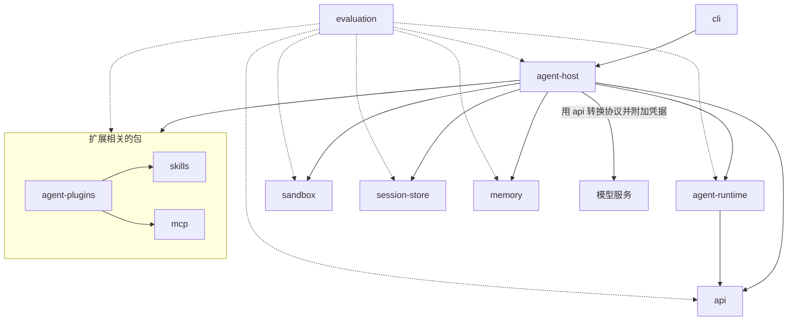
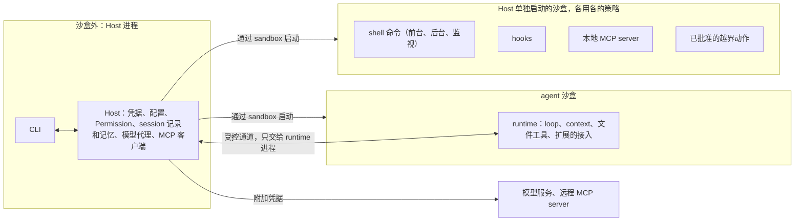

# Coding Agent 总体设计

日期：2026-11-06（Asia/Shanghai）  
状态：架构规划，供搭建 monorepo、实现和验收使用。

目标：一个运行在用户电脑上、通过 CLI 使用的 coding agent，名为 Osprey Code（见[名字](#名字)）。组成它的每个包都按对外发布的 SDK 标准来做（见 [SDK 标准](#sdk-标准)），可以单独给其他项目使用。

文档里的目录名和接口名只是示意；各文档反复出现的词按下文[术语](#术语)理解。"调研"指 2026-11-04 对沙盒、命令筛选和 memory 项目做的调研；外部项目、规范、版本号和 Codex 权限设计的信息核对于 2026-11-06。

第一次阅读的顺序：[十一个包](#十一个包)、[运行时的部署](#运行时的部署)、[一次任务的流程](#一次任务的流程)，再按需要读 `docs/packages/` 下各包的文档。每个阶段交付哪些功能，见[实施计划](roadmap.md)。

## 术语

| 术语 | 含义 |
|---|---|
| 包 | 本项目的组成部分，即 `packages/` 下的十一个 npm 包 |
| 仓库 | agent 处理的用户项目，例如"仓库自带的配置" |
| Host | 沙盒外的本地后端，首版和 CLI 在同一个进程里。持有凭据、配置、权限决定、session 记录和记忆数据，启动和管理 agent 进程 |
| agent 进程 | Host 通过 `sandbox` 启动、在 agent 沙盒里运行的进程，每个打开的 session 一个。里面运行的代码称为 runtime（loop、上下文、文件工具和扩展的接入） |
| 命令沙盒 | Host 为每条 shell 命令（前台、后台和监视）和每次 hook 单独启动的沙盒，按启动时的策略限制；命令不在 agent 沙盒里运行（见 sandbox 的[命令的执行](packages/sandbox.md#命令的执行)） |
| 通道 | Host 和 agent 进程之间唯一的连接，只开放完成任务需要的操作；接口由 `agent-runtime` 定义、Host 实现（见 agent-runtime 的[通道](packages/agent-runtime.md#通道)） |
| Permission | `sandbox` 包里在 Host 一侧做权限判断的模块：审批策略、权限规则、越界申请和批准记录 |
| 权限规则 | 对命令前缀、域名和 MCP 工具写明放行、询问或禁止的规则；内置的随 `sandbox` 包发布，用户和仓库的写在 `rules/*.toml` 里（见 sandbox 的[规则](packages/sandbox.md#规则)） |
| 规则文件 | 给模型读的指令文件，即 `AGENTS.md`、`CLAUDE.md` 等，分用户级和仓库里的两种；只是模型的输入，不改变权限（见 agent-runtime 的[工具集、系统指令和模型切换](packages/agent-runtime.md#工具集系统指令和模型切换)） |
| 工作区 | 启动 Host 时的当前目录，`workspace-write` 下可写的就是它（见 sandbox 的[沙盒模式](packages/sandbox.md#沙盒模式)） |
| 越界 | 动作超出当前沙盒模式允许的范围；模型通过越界申请要求更多权限，批准后由 Host 在新的受限进程里执行（见 sandbox 的[越界申请](packages/sandbox.md#越界申请)） |
| 扩展、插件 | 扩展是 MCP、Skills、插件和 hooks 四种机制的统称；插件专指 Agent Plugins 格式的安装包 |
| session | 可以包含多个 task 的会话。打开期间有一个 agent 进程，后台命令也属于它；用户退出 CLI 时关闭，Host 结束其中的全部进程；关闭后可以恢复（见 agent-host 的 [session 的打开和关闭](packages/agent-host.md#session-的打开和关闭)） |
| task | 用户要完成的一件事，由 session 空闲时的一次输入开始（见 agent-host 的[标识](packages/agent-host.md#标识)） |
| run | task 的一次执行；恢复、回退和分叉都开始新的 run |
| 一轮 | 一次模型请求加上它返回的全部工具调用 |
| tool call | 一次工具调用；执行前向 Host 登记，由 Host 分配 `tool_call_id` |
| steering、follow-up | task 运行中用户的两种输入：steering 并入当前 task；follow-up 排进列表，等当前 task 完成后开始新的 task（见 agent-runtime 的[运行中的用户输入](packages/agent-runtime.md#运行中的用户输入)） |
| 后台命令 | 放到后台运行的命令，属于 session，跨 task 保留（见 agent-runtime 的[后台命令](packages/agent-runtime.md#后台命令)） |
| session 记录 | Host 通过 `session-store` 保存的只追加事件；恢复、回退和评测都依据它 |
| 恢复 | 中断（退出、崩溃、重启 agent 进程）之后按 session 记录接着执行（见 agent-host 的[中断后的恢复](packages/agent-host.md#中断后的恢复)） |
| 快照 | Host 在工具调用执行前保存的工作区内容，只用于撤销和还原，不影响权限 |
| 检查点 | 每次用户输入时的还原点：session 记录里的位置加对应的快照；回退会话、撤销改动时用它还原文件（见 session-store 的[会话的分支和回退](packages/session-store.md#会话的分支和回退)） |
| 回退、分叉 | 回退把会话的当前位置移回某次用户输入之前；分叉从某个位置复制出新的 session |
| 内部协议 | `api` 包定义的模型请求格式，其他包只用它（见 [api](packages/api.md)） |
| 模型代理 | Host 里转发模型请求的部分：检查模型和预算，用 `api` 转换协议并附加凭据 |

## 十一个包

| 包 | 负责什么 | 首版方向 |
|---|---|---|
| `sandbox` | 判断 agent 能不能做某件事，并由操作系统限制它实际能做的事 | 适配 anthropics/sandbox-runtime |
| `session-store` | 保存 session 记录：事件、会话树（回退和分叉）、检查点索引和按引用保存的大内容 | 自研，用 Node 自带的 `node:sqlite` |
| `memory` | 从 session 记录里提炼长期记忆，按 project 和 user 两种范围查找、纠正和删除 | 自行设计，参考调研中的多个项目 |
| `api` | 定义模型请求的内部协议，并在它和各家协议（`openai.chat`、`openai.responses`、`anthropic.messages` 等）之间转换 | 自研，首批支持这三种协议 |
| `skills` | 按 Agent Skills 规范解析、校验和查找 skills | 自研，只实现规范本身 |
| `mcp` | MCP 客户端：协议版本、传输方式（stdio、Streamable HTTP）和 OAuth 授权 | 封装 MCP 官方客户端 SDK，只实现协议本身 |
| `agent-plugins` | 按 Agent Plugins 1.0.0 读取和校验插件目录，找出其中的 skills 和 MCP server，解析 `mcp.json` | 自研，只实现规范本身 |
| `agent-runtime` | 拿到任务后调用模型和工具把它做完：loop、tools、扩展的接入，以及它和 Host 之间的通道接口 | 自研 |
| `agent-host` | 本地后端（Host）：管理会话和任务，持有凭据和配置，管理扩展，把其他包组装起来 | 供 `cli` 和评测嵌入的 SDK |
| `cli` | 命令行界面：命令和参数、交互界面、非交互运行和对外的事件流 | 交互界面用 pi 的终端界面库 |
| `evaluation` | 检查各部分单独和组合起来是否真的有效 | 分 agent 能力评测和 sandbox 专项评测两类 |

各包的设计见 `docs/packages/` 下的同名文档；`cli` 只是 Host 的一层界面，设计写在 agent-host 的 [CLI](packages/agent-host.md#cli) 一节。

- 兼容不同的模型协议是必须支持的能力：各家协议都和 `api` 的内部协议互转，其他包只用内部协议，换模型服务不改其他包（见 [api](packages/api.md)）。
- 扩展也是必须支持的能力（"扩展"和"插件"见[术语](#术语)）。MCP、Skills、插件按公开的通用规范实现、不自造变体，分别由 `mcp`、`skills`、`agent-plugins` 负责，其他 agent 生态里按这些规范发布的扩展可以直接使用；各家自有格式的插件（如 Claude Code 的）不能直接加载。Hooks 自行设计，由 Host 在固定时机触发，每次在单独的沙盒里运行（见 agent-host 的 [Hooks](packages/agent-host.md#hooks)）。扩展的启用、信任和权限规则见 agent-host 的[扩展的管理和信任](packages/agent-host.md#扩展的管理和信任)。

## 代码组织

十一个包放在同一个 git 仓库里，组织方式照 [pi](https://github.com/earendil-works/pi)（commit `d7a988d`），工具见[工程约定](#工程约定)：

```text
coding-agent/
  package.json          根配置：private，用 npm workspaces 管理各包，统一的 build、check、test、版本和发布脚本
  tsconfig.base.json    各包共用的 TypeScript 配置
  tsconfig.json         把包名映射到各包的 src，跨包类型检查不用先构建
  packages/
    sandbox/            对外发布
    session-store/      对外发布
    memory/             对外发布
    api/                对外发布
    skills/             对外发布
    mcp/                对外发布
    agent-plugins/      对外发布
    agent-runtime/      对外发布
    agent-host/         对外发布：Host 的 SDK
    cli/                对外发布：CLI 命令和交互界面，打包成一个文件
    evaluation/         private，不发布，同样按 SDK 标准来做
  scripts/              版本同步、依赖检查和发布脚本
  docs/                 本文和 packages/ 下各包的设计文档
  AGENTS.md             文件地图和编码规则（不另建 CLAUDE.md）
```

- 每个包有自己的 `package.json`、`src/`、`test/`、`README.md` 和 `CHANGELOG.md`；设计文档列出的模块是该包 `src/` 下的目录，不单独发布。
- 公开接口只由 `package.json` 的 `exports` 声明，其他包只能经这些入口引用，不能直接引用 `src/` 下的文件。
- 包之间的依赖写在各自的 `package.json` 里；检查脚本确认每个包的源码只引用声明过的依赖，[依赖方向](#依赖方向)由此自动检查。
- 所有发布的包用同一个版本号，一起升级、一起发布，包之间的依赖固定到这个确切版本。
- 根目录的 `npm run check` 做格式、lint、类型检查和依赖检查，`npm test` 运行各包的测试。测试从干净的环境变量和临时的 HOME 目录开始，只传入需要的设置；测试用模型的密钥写在只对当前用户可读写（0600）的文件里，只传入文件路径，并把这个文件列入沙盒的读取禁止名单（原因见 [CI 和真实模型测试](#ci-和真实模型测试)）。
- 每个包单独维护 CHANGELOG，未发布的改动记在 `## [Unreleased]` 下。

## SDK 标准

每个包都按对外发布的 SDK 来做，可以脱离本项目单独使用；`evaluation` 不发布，也照此要求。

- **公开接口**：只通过 `exports` 对外，并随包发布类型声明。导出的函数、类型和错误类型都是公开接口，改动它们就是改动接口。
- **不依赖隐含的环境**：不使用进程级的全局状态；存储位置、通道、日志等依赖由调用方显式传入。不得不依赖全局状态时（如 sandbox-runtime 的 `SandboxManager` 是进程级单例，初始化时还注册进程的 SIGINT 和 SIGTERM 处理函数），在接口说明和文档中写明。
- **文档和示例**：README 说明用途、安装方法、最小可运行示例、主要接口、平台要求和许可证；公开接口都有注释说明。
- **版本和兼容**：遵循语义化版本（1.0 之前的约定见[版本号](#版本号)）。破坏性改动写进 CHANGELOG 的 `### Breaking Changes` 并给出迁移方法；存储格式和事件格式变化时提供数据迁移。
- **依赖**：新增运行时依赖要有理由，固定到确切版本，引入前核对许可证；安装时不需要依赖的生命周期脚本；不引入 AGPL 依赖。
- **测试**：除包内的单元测试，还要有只通过公开接口的测试。发布前把包打包，在 monorepo 之外的干净项目里安装并运行示例，确认它不依赖 monorepo 里的路径和配置。

## 工程约定

### 语言和运行环境

用 TypeScript（Node.js），与 pi 和 sandbox-runtime 一致。

- Node 最低 24.15.0，`engines.node` 写 `^24.15.0 || >=26.0.0`（25 是不进入 LTS 的奇数版本）。开发和 CI 以 Node 26 LTS（26.13.0）为主，CI 同时在 24.15.0 上运行。下限取 24.15.0：`node:sqlite` 从这个版本起为 Release candidate、不再输出实验性警告，session-store 用它存储；`http.setGlobalProxyFromEnv()` 从 24.14.0 起可用，Node 的 `fetch` 默认不用 `HTTPS_PROXY`，评测容器要求经代理访问模型服务时由 Host 在代码里显式开启。不选 22：它在 2027-04-30 结束维护，项目中途就要再改下限。其他依赖的要求都更低（sandbox-runtime 22.12 以上，MCP 官方客户端 20 以上）。
- `engines` 只产生警告，仓库里的 `.nvmrc` 之类的文件还能让版本管理器换掉 Node，所以 Host 启动时检查 `process.versions.node`，不满足就报错退出。
- CLI 只以 npm 包分发：`cli` 包用 esbuild 把自己和全部 JS 依赖打成一个文件（照 pi v1.5.0），用 `npm install -g --ignore-scripts` 安装。打包也是在构建时固定传递依赖（如 sandbox-runtime 用 `^` 写的 4 个依赖）的办法：npm 12 不再读取 `npm-shrinkwrap.json`，全局安装也不用包里的 lockfile；单独使用 SDK 包的项目由自己的 lockfile 固定。sandbox-runtime 的 `vendor/` 文件随 `cli` 包发布，适配层确认 `apply-seccomp` 等文件存在后显式传入路径，不存在就停止，不让它退回 `npm root -g`、`~/.npm-global/lib` 这类用户可写的位置去找。
- 不做单文件可执行程序：Node 26 的单文件程序仍在开发阶段（ESM 入口的产物约 145 MB，原生模块要先写到临时文件再加载）；不用 Bun 编译，它的产物默认读取当前目录的 `.env` 和 `bunfig.toml`，等于让仓库文件改 Host 的环境。

### 工具链

照 pi 的组织，几处按本项目的要求调整。

- npm workspaces 加根目录的 `package-lock.json`；`.npmrc` 设 `save-exact=true` 和 `min-release-age`；CI 用 `npm ci --ignore-scripts`，GitHub Actions 引用的 Action 固定到 commit SHA；不用 husky 这类需要 `prepare` 脚本的工具。
- 各包用 TypeScript 7（7.0.2）的 `tsc` 编译，只发布 ESM，`exports` 只写 `types` 和 `import`，不加指向源码的 `source` 条件：跨包类型检查用 `tsconfig.json` 的 `paths`，测试用 vitest 的 alias，发布的 `exports` 不会指向没有发布的文件。
- `cli` 包另用 esbuild（0.28.2）打包。
- 测试用 vitest 5（5.1.0），搭骨架时取已满 `min-release-age` 的最新 5.x。
- lint 和格式化用 Biome（2.6.5），开启 `noUndeclaredDependencies`，只允许测试和脚本使用 devDependencies。依赖声明的检查交给它，不照 pi 用 TypeScript 的 API 写脚本：TS 7 只在 `typescript/unstable/*` 下提供编程接口，每次升级都可能要改。
- 其余检查写成不依赖第三方库的 Node 脚本：直接依赖写确切版本，各包版本一致，包之间的引用符合[依赖方向](#依赖方向)，`npm sbom` 列出的许可证都在白名单内（见[许可证](#许可证)），打包后能在 monorepo 之外安装。
- 通道消息的 schema 用 `typebox`（见 agent-runtime 的[通道](packages/agent-runtime.md#通道)）。
- 发布由 tag 触发，CI 执行 `npm publish --provenance --ignore-scripts`，不用 changesets。用 npm 的 trusted publishing（OIDC，在 GitHub Actions 上自动生成 provenance）和 staged publishing（维护者用 2FA 批准后版本才公开）；npm 上的包设为要求 2FA、禁止令牌发布，granular token 直接发布的能力在 2027 年 1 月取消。Node 26 自带的 npm 11.20.0 满足 staged publishing 要求的 11.15.0，CI 不另装 npm。

### 支持的平台

先跑通开发机所用的 macOS。评测在 Linux 容器里运行，所以 agent 本身（不启用沙盒）从 P1 起也要能在 Linux 上运行。

- macOS 只支持 Apple Silicon，最低 macOS 15。CI 在 GitHub 托管的 `macos-15` 和 `macos-26`（arm64）上用真实沙盒测试；Node 24 和 26 的官方二进制最低支持 macOS 13.5，但支持范围以 CI 能用真实沙盒测到的版本为准。不列入 Intel Mac：Node 26 已把 macOS x64 降为 Tier 2，2028 年初起转为 experimental（26.13.0 的 `BUILDING.md`），不为一个正在缩小的平台把沙盒测试翻倍。
- Linux 上 agent 本身（不启用沙盒）从 P1 起支持 x64 和 arm64 的 glibc 发行版，要求 glibc 2.28 以上；用 Node 26 时还要有 `libatomic1`（26.13.0 的 Linux 二进制依赖它，24.22.2 不依赖）。评测镜像 mars-base（Debian 12.12，glibc 2.36）满足这两项，但预装的 Node 24.12.0 低于下限，评测的安装步骤自带固定版本的 Node。不支持 musl（Alpine）：Node 的 musl 构建只有 x64、为 Tier 2，评测镜像也都是 Debian。
- Linux 沙盒由适配层在启动时按条件检查，不按发行版名判断：bubblewrap 0.8.0 以上且不是 setuid 安装，x64 或 arm64，非特权 user namespace 里能拿到能力，没有加载 `bwrap-userns-restrict`；任何一项不满足就报告不支持并停止。首个列入支持的发行版是 Ubuntu 24.04（自带 bubblewrap 0.9.0）：安装说明按它的发行说明给出允许 `bwrap` 使用 `userns` 的 AppArmor 配置，由用户以 root 安装，不整体关闭 `kernel.apparmor_restrict_unprivileged_userns`。Ubuntu 22.04（bubblewrap 0.6.1）不支持；Ubuntu 26.04 的 `apparmor` 包自带 `bwrap-userns-restrict`（24.04 的不带），在 sandbox-runtime issue #429 解决前不支持。Debian 12、13 和 Fedora 43 起的 bubblewrap 满足版本要求，但 CI 没有现成的 runner，不列入已测试，启动检查通过就能运行。
- 不支持 Windows：sandbox-runtime 的 Windows 后端还是 alpha，Node 在那上面只能传三个标准流、通道用不了 fd 3，也没有 CI runner 验证。

### 名字

本项目叫 Osprey Code，取自鱼鹰（osprey）：它在水面上空盘旋观察，看准了才俯冲，一击取鱼；coding agent 也该先读懂代码再动手，改动要准。名字带 code（照 OpenCode 等的惯例），一看就知道是写代码的 agent。

- 机器用的名字统一为 `ospreycode`：npm scope、CLI 命令名、GitHub 组织名、仓库里本项目的配置目录（`.ospreycode/`）、Host 的根目录（`~/.ospreycode/`，见 agent-host 的[目录位置](packages/agent-host.md#目录位置)）和域名（`ospreycode.dev`），用户和沙盒规则只需要认一个名字。命令不用更短的 `osprey`：粒子加速器控制系统的 agent 框架 Osprey（PyPI 的 `osprey-framework`）已经用了它。
- 选名的标准：看得出是一个 coding agent，不只描述其中一个组件；机器名不超过 10 个小写字母；npm 上没有同名的用户、组织和包（`https://registry.npmjs.org/-/org/<名字>/package` 和 `/-/user/<名字>/package` 都返回 404；`www.npmjs.com` 的页面对脚本请求返回 403，不能用来判断）；GitHub 上没有同名账号；命令名不与常见命令、Homebrew 和 Debian 的包名、其他 agent 重名；配置目录不与 `.agents`、`.claude`、`.codex`、`.gemini`、`.pi`、`.cursor`、`.opencode` 撞名；域名可以注册；软件类别里没有相近的商标和同类产品。
- 2026-11-06 核对：ospreycode 在 npm（用户、组织和包）、GitHub、Homebrew（formula 和 cask）和 Debian 上都没有被占用，`ospreycode.dev` 和 `ospreycode.com` 都没有注册；同名的只有上面的 Osprey 框架，领域不同。
- 最初定的 siltbox 落选：取自沙盒，只描述了沙盒这一个组件，看不出是 coding agent；其余候选都没有通过上面的标准。
- P0 先注册 npm 组织 `ospreycode`（组织名即 scope，公开包免费，只有成员能在其中发布）、GitHub 组织 `ospreycode` 和域名 `ospreycode.dev`，同时注册 `ospreycode.com` 防止被抢注；域名由项目负责人的账户持有并开启自动续费。不用 `<组织>.github.io` 这类子域名：Agent Plugins 的命名空间发布后不能再改，而 GitHub 组织改名后旧名字可以被别人注册。
- 发布的包命名为 `@ospreycode/<包目录名>`，如 `@ospreycode/sandbox`；CLI 的包是 `@ospreycode/cli`，命令名是 `ospreycode`，不另占无 scope 的包名。首次发布加 `--access public`（scoped 包默认私有）。
- Agent Plugins 的命名空间是 `dev.ospreycode`（规则见 agent-plugins 的[命名空间](packages/agent-plugins.md#命名空间)），MCP 授权用的客户端元数据文件放在 `https://ospreycode.dev/` 下的固定路径（见 mcp 的[要点](packages/mcp.md#要点)）。

### 版本号

- 从 0.1.0 开始，所有发布的包用同一个版本号。1.0 之前，破坏性改动升 minor，新增功能和修复升 patch，与 npm 的 `^` 语义一致（`^0.3.1` 只接受 0.3.x），使用者不会被自动升级到不兼容的版本。每个破坏性改动记入该包 CHANGELOG 的 `### Breaking Changes` 并给出迁移方法，不保留兼容旧接口的代码。不从 1.0 开始：依赖的 sandbox-runtime 还是 0.0.x 的 Beta，P0 还有一个可以丢弃的原型，这时承诺 1.0 的兼容会逼出兼容层。
- 落盘的数据（session 记录、记忆、配置）和 CLI 的对外事件从第一版起带格式版本号，读到不认识的版本时报错，不猜测内容；存储格式变化时从第一次发布起就提供数据迁移，因为用户的记录比程序版本存在得久。
- 公开接口在一个阶段内没有破坏性改动、并已有外部使用者依赖时发布 1.0，之后按 SemVer 2.0.0：破坏性改动只进 major，删除接口前至少有一个 minor 先标记弃用。不照 pi 在 1.0.0 之后仍在 minor 里做破坏性改动：使用者写 `^1.5.0` 时会被自动升级到不兼容的版本。

### 许可证

使用 Apache-2.0，所有包相同。

- Apache-2.0 带明确的专利授权（第 3 条，被许可人发起专利诉讼时终止），并与要照搬或移植的上游一致：Codex、sandbox-runtime 和 Agent Skills 规范仓库都是 Apache-2.0，MCP 官方 SDK 从 2.3.0 起也由 MIT 改为 Apache-2.0；参照的 pi 是 MIT，它的代码连同版权声明可以并入。
- 移植 Codex 的代码、权限规则、Seatbelt 配置或测试数据时，按 Apache-2.0 第 4 条保留原有的版权和归属声明，在改过的文件里注明修改，并把 Codex `NOTICE` 中的归属内容并入本项目的 `NOTICE`。
- npm 只自动打包包根目录的 `LICENSE`，workspace 根目录的文件不会进入各包的 tarball，所以每个包目录各放一份，`package.json` 的 `license` 写 `"Apache-2.0"`。
- `cli` 包用 esbuild 打包后，依赖自带的许可证文件不再随包发布，而 MIT、BSD-3-Clause、Apache-2.0 都要求分发时附带许可证文本，所以构建时根据 lockfile 生成第三方许可证文件放进 `cli` 包。
- 每个依赖和评测数据集固定版本时核对许可证；许可证会随版本变化（如上面的 MCP 官方 SDK），升级时重新核对。CI 用 `npm sbom` 列出全部运行时依赖的许可证，脚本按 SPDX 表达式检查是否都在白名单内；表达式含 `OR` 时记录选用的许可证，例如 sandbox-runtime 依赖的 node-forge 是 `(BSD-3-Clause OR GPL-2.0)`，选用 BSD-3-Clause。
- sandbox-runtime 随包发布的 `vendor/` 二进制 `npm sbom` 看不到，单独列出。0.0.81 的 `vendor/seccomp/{x64,arm64}/apply-seccomp` 不含 libseccomp（它只在构建时生成 BPF 过滤规则，规则以字节数组编进程序），但它是在 Ubuntu 24.04 上用 GCC 13.3 静态链接 glibc 的程序，glibc 是 LGPL-2.1-or-later，npm 包里也没有它的源码（`vendor/seccomp-src`）。所以 `cli` 包附上 LGPL-2.1 的文本并写明 glibc 的来源版本，每次发布在同一个 GitHub Release 里附上对应 sandbox-runtime 版本的 `vendor/seccomp-src` 和 Ubuntu 24.04 的 glibc 源码包，满足 LGPL-2.1 第 6 条对静态链接的要求；升级 sandbox-runtime 时重新检查这些二进制。
- 贡献用 DCO：每个提交带 `Signed-off-by`，CI 检查。不用 CLA：本项目没有收存协议的法律实体，Apache-2.0 第 5 条已规定提交的贡献按本许可证授权，DCO 补上来源的声明。

### CI 和真实模型测试

需要模型的测试用便宜的真实模型联网运行（见 AGENTS.md 的测试规则），不照 pi、opencode、Codex 和 Aider 在 CI 里跳过（`describe.skipIf`）、回放录制或模拟模型服务的做法。

- CI 用 GitHub Actions，runner 固定版本。每个 PR（包括 fork 和 Dependabot 的）运行 `npm run check` 和不带 vitest `model` 标签的测试，不配置密钥：`sandbox` 包自己的测试在 `ubuntu-24.04`、`ubuntu-24.04-arm`、`macos-15`、`macos-26` 四个 runner 上用真实沙盒运行，其余包在 `ubuntu-24.04` 和 `macos-15` 上运行，与 evaluation 的 [Sandbox 专项评测的运行环境](packages/evaluation.md#sandbox-专项评测的运行环境)一致。
- 需要模型的测试标上 `model`，只在合并队列（`merge_group`）、每日定时和手动触发时在 `ubuntu-24.04` 上运行。密钥放在只允许 `main` 和 `gh-readonly-queue/main/*` 使用的 environment 里；fork 的改动经维护者审查、进入合并队列后才和密钥一起运行，信任级别和合并相同。不用 `pull_request_target`：它在带密钥的上下文里运行 PR 的代码，GitHub 也从 2026-12-02 起在公开仓库默认禁止它。仓库放在 GitHub 组织 `ospreycode` 名下，合并队列可用。
- 选中了模型测试却缺少密钥时直接失败：PR 上排除 `model` 标签是命令显式选择的，不取决于有没有密钥，所以不用 `skipIf`。
- 密钥来自专用的 OpenAI 项目、Anthropic 工作区和 DeepSeek 账户，各设 100 美元的月度硬上限，兜住密钥泄露和客户端计费出错。由单独的步骤写入 0600 的文件，干净环境里只传文件路径，测试把这个文件列入沙盒的读取禁止名单：macOS 上沙盒内能读到同一用户其他进程的初始环境变量（见 sandbox 的[沙盒后端](packages/sandbox.md#沙盒后端)），开着沙盒的测试会读到经环境变量传入的密钥。
- 测试用的模型：`openai.responses` 和 `openai.chat` 用 `gpt-6-luna`（它在 Chat Completions 里只有 `reasoning_effort: none` 时才能调用工具）；`openai.chat` 的推理加工具调用用直连的 `deepseek-flash`（它要求带回 `reasoning_content`，正好测这条转换规则）；`anthropic.messages` 用 `claude-haiku-5-5`。DeepSeek 在工作日高峰时段价格加倍，模型清单的价格结构要能表达。
- 每个测试显式给出 run 的费用、请求次数和时间上限（0.05 美元、20 次、5 分钟），顺带测了 Host 的预算功能；测试进程内的账本超过每次运行的上限（1 美元）后，其余模型测试失败。
- 断言只检查结构化结果：停止原因、工具名和按 schema 校验的参数、文件结果和退出码、事件和 session 记录的完整性、用量和错误类别，不检查模型写的原文。
- 照 Codex（rust-v0.167.0）的 nextest 重跑一次，但只对 `api` 归为限流、服务过载、网络中断和超时的失败重跑（vitest 标签上的 `retry.condition`，实测只重跑匹配的错误）；断言失败也重跑会掩盖只在部分请求里出现的转换错误。重跑后才通过的测试按 `diagnostic().flaky` 记为不稳定，写进 job summary。

## 结构图



实线是依赖关系，虚线是评测关系。`agent-runtime` 只依赖 `api`；其余的包都只在 Host 一侧使用，runtime 需要它们的能力时经通道向 Host 请求（见下文[运行时的部署](#运行时的部署)）。`agent-host` 依赖 `agent-runtime` 只是为了实现它定义的通道接口、找到 agent 进程的入口，runtime 本身在沙盒里的另一个进程中运行。产品运行时不需要 `evaluation`。

## 依赖方向

- `sandbox`、`session-store`、`memory`、`api`、`skills` 和 `mcp` 不依赖本项目的其他包，这样才能单独复用。`memory` 需要调用模型、读取 session 记录或检测密钥时，由调用方传入发起调用的函数、session 的内容或检测函数。
- `agent-plugins` 只依赖 `skills` 和 `mcp`：插件里的 skills 交给 `skills` 解析，MCP server 声明转成 `mcp` 的 server 定义。
- `agent-runtime` 只依赖 `api`。它需要的其他能力（工具调用的登记和权限、MCP 工具、skill 的内容、session 记录、记忆）都经通道向 Host 请求；通道接口由 runtime 定义、Host 实现（见 agent-runtime 的[通道](packages/agent-runtime.md#通道)），runtime 不依赖 `agent-host`。Host 先把插件展开成 skills 和 MCP 工具，再交给 runtime。
- `agent-host` 依赖以上全部包。
- `cli` 只依赖 `agent-host` 和终端界面库：命令、交互界面和非交互输出都在这里，`agent-host` 不带界面的依赖，评测和其他嵌入 Host 的程序不会装上它们。
- `evaluation` 只通过公开接口调用其他包。产品代码不依赖它。
- 配置：每个包导出自己那部分配置的类型和校验（如 `sandbox` 的权限配置和规则、`api` 的模型清单条目），Host 的 `config/` 只负责读取、分层合并和执行仓库配置的限制，不重新定义它们（见 agent-host 的[模块](packages/agent-host.md#模块)）。

user、project、session、task、run、tool call 这些标识由 Host 生成（见 agent-host 的[标识](packages/agent-host.md#标识)），`sandbox`、`session-store` 和 `memory` 把它们当作普通字符串接收。事件的归属：公共字段和存储格式由 `session-store` 规定（见 session-store 的[事件格式](packages/session-store.md#事件格式)），CLI 的对外事件格式由 `agent-host` 定义，两者分开；模型的消息和流式事件按 `api` 的内部协议；runtime 自己的事件（工具调用、上下文压缩、用户输入插入的位置）由 `agent-runtime` 定义，其中工具调用事件的格式在 `agent-runtime` 的 `contracts/`，`tool_call.started` 和 `tool_call.completed` 一律由 Host 写入；任务、批准、命令、hooks 和进程事件由 `agent-host` 定义。runtime 不依赖 `agent-host`，所以经通道上报的只有前两类，最后一类由 Host 自己产生。

## 运行时的部署

正常使用时，agent 的执行进程（loop、工具、扩展和它们启动的子进程）始终运行在系统沙盒里；凭据、配置、权限决定、session 记录和记忆数据都放在沙盒外的 Host 中。沙盒内的代码，包括 runtime 自己，都按可能被攻破处理：真正起限制作用的是系统沙盒和沙盒外的 Permission，沙盒内的检查（比如编辑前询问用户）只服务于交互，不作为安全保证。评测环境不启用沙盒，见 [evaluation](packages/evaluation.md)。



| 位置 | 包含 | 规则 |
|---|---|---|
| 沙盒外：Host | 凭据、配置、权限策略和批准记录、扩展的信任记录、session 记录和记忆数据及它们的范围检查、进程管理 | Agent 不能直接读写这些数据 |
| 沙盒内：Agent | runtime 的 loop、上下文处理、文件工具和扩展的接入 | 文件、网络、进程都受 agent 沙盒的策略限制；这个策略在 agent 进程启动时固定，不能联网 |
| 沙盒内：命令沙盒 | shell 命令（前台、后台和监视）、hooks、本地 MCP server、批准的越界动作，以及它们启动的子进程 | Host 每次按当时的策略（越界时按批准的权限）单独启动，输出经 Host 交回 runtime |
| 两者之间的接口 | 由 agent-runtime 的 `channel/` 定义，完整清单见 agent-runtime 的[通道](packages/agent-runtime.md#通道)：启动配置（`initialize` 的响应）、模型请求（`api` 的内部协议）、工具调用的登记和执行（Host 分配 `tool_call_id`）、权限申请、MCP 工具的调用（声明由 Host 在启动配置里给出）、skill 的完整内容、session 记录和按引用保存的大内容、记忆、runtime 的事件、Host 的通知、用户输入、后台命令、取消和状态查询；子 agent（P5）作为单独的 agent 进程运行（见 agent-runtime 的[子 agent](packages/agent-runtime.md#子-agent)） | 只开放完成任务需要的操作。Host 只执行经过 Permission 批准、并在新沙盒里运行的动作，不提供在沙盒外直接执行命令的入口。Host 按通道判断请求属于哪个 session，再按自己的记录确定当前的 task 和 run，不采信请求里填写的标识 |

沙盒内只运行 `agent-runtime` 和它用到的 `api` 内部协议；`sandbox`、`session-store`、`memory`、`skills`、`mcp` 和 `agent-plugins` 都只在 Host 一侧使用，所以信任边界上只有通道这一份接口要检查，协议转换和附加凭据也都在 Host 一侧完成。

不照 Codex 把核心进程放在沙盒外、只给命令套沙盒：本项目的 loop 也在沙盒里，runtime 需要的配置都由 Host 读取后交给它，runtime 不自己读用户级配置。命令和 hooks 每次单独套沙盒，由 Host 按当时的策略启动，切换策略、结束进程和网络审批都以单条命令为单位（见 sandbox 的[命令的执行](packages/sandbox.md#命令的执行)）。

## 一次任务的流程

下面按顺序串起一次任务经过的各个部分，细节见链接的各包文档。

1. **启动**：用户在某个目录运行 CLI。Host 把这个目录定为工作区，判断项目身份，读取用户级和项目级配置，确定沙盒模式和审批策略，取得工作区锁（session 打开时取得、关闭时释放），运行会话开始的 hooks，启动本地 MCP server 并等它们就绪（P2），再通过 `sandbox` 启动 agent 进程。agent 进程的第一条请求 `initialize` 带 `agent-runtime` 的包版本，Host 最多等 30 秒，响应就是 runtime 需要的配置（见 agent-runtime 的[从 Host 得到的配置](packages/agent-runtime.md#从-host-得到的配置)）。
2. **开始 task**：用户提交输入，Host 生成 task 和 run，把输入经通道交给 runtime。
3. **请求模型**：runtime 用内部协议组织请求，经通道发给 Host。Host 的模型代理检查模型和预算，用 `api` 转换成目标协议、附加凭据后发出，再把流式响应转换回内部事件交给 runtime，并记录用量（见 api 的[在系统中的位置](packages/api.md#在系统中的位置)）。
4. **执行工具**：模型要调用工具时，runtime 先向 Host 登记，Host 分配 `tool_call_id`。登记后的顺序固定：工具调用前 hooks → Permission → 快照（P3 起）→ 执行（见 agent-runtime 的[工具执行](packages/agent-runtime.md#工具执行)）。Permission 按权限规则、内置的危险命令判断和模型的越界申请作出决定：
   - 没有命中规则，也没有申请越界：shell 命令由 Host 按当前策略单独启动命令沙盒执行，输出经通道流式交回 runtime；文件工具由 runtime 在 agent 沙盒里直接执行，写进受保护路径的请求在登记时就被拒绝（见 sandbox 的[命令的执行](packages/sandbox.md#命令的执行)）。被沙盒拦下的命令，失败结果附沙盒信息交回模型，由模型决定是否申请越界。
   - 命中 `forbidden`，或需要询问但审批策略不允许询问：拒绝，原因交回模型。
   - 命中 `prompt` 规则或危险命令判断，或模型申请越界：Host 经 CLI 询问用户。批准后按这次调用申请的权限（没有申请越界就是当前策略）由 Host 新启动的沙盒执行。命中 `allow` 规则只免去询问（申请的额外权限要在规则声明的范围内），执行方式相同（见 sandbox 的[越界申请](packages/sandbox.md#越界申请)和[规则](packages/sandbox.md#规则)）。
   - 命令访问还没放行的域名：由 Host 一侧的网络代理拦下，按 sandbox 的[网络访问的审批](packages/sandbox.md#网络访问的审批)处理。
   - MCP 工具：runtime 经通道请求调用，Host 检查是否获准后作为 MCP 客户端代为调用，默认每次询问（见 mcp 的[只在 Host 一侧使用](packages/mcp.md#只在-host-一侧使用)）。

   Host 代为执行的工具（shell、MCP、越界动作）的结果由 Host 直接保存，runtime 只提交自己执行的文件工具的结果；结果都交回模型。
5. **继续或结束**：runtime 重复第 3、4 步，直到模型给出最终回复、超出预算或被取消。期间用户可以发送 steering，或者把 follow-up 排进列表。runtime 报告 task 结束后，列表里有 follow-up 时由 Host 开始下一个 task；后台命令继续运行，session 空闲时它们的通知由 Host 开始新的 task 处理，连续由后台通知开始的 task 最多 3 个（见 agent-runtime 的[运行中的用户输入](packages/agent-runtime.md#运行中的用户输入)和[后台命令](packages/agent-runtime.md#后台命令)）。
6. **退出**：用户退出 CLI 时 session 关闭，Host 按固定顺序收尾：会话结束的 hooks → 结束 agent 进程和这个 session 的全部沙盒 → 保存事件 → 释放工作区锁（见 agent-host 的 [session 的打开和关闭](packages/agent-host.md#session-的打开和关闭)）。之后可以恢复这个 session（见 agent-host 的[中断后的恢复](packages/agent-host.md#中断后的恢复)）。

## 所有包都遵守的规则

- 模型读到的内容，包括仓库文件、网页、工具输出、扩展内容和历史记忆，都不能改变权限。只有用户的批准和 Host 的配置能改变权限。
- 身份和可访问范围由 Host 提供，不接受模型或沙盒内代码自己填写的 user 或 project ID。
- 一次批准只对应一个具体动作（或同一资源上的同类动作）、一个任务和一个有效期，执行前再检查一次。需要长期生效的放行，由用户写进仓库以外的配置，成为权限规则。历史记录可以用来恢复和核对，但不能产生新的授权。
- 沙盒后端做不到要求的隔离时，报告不支持并停止执行，不降级运行。
- 关闭沙盒（沙盒模式 `danger-full-access`）必须在启动时显式指定，并在输出和记录中标明。仓库里的配置和模型的请求都不能关闭沙盒。
- Host 在沙盒外读取仓库里的文件（项目配置、权限规则文件、`.git` 下的文件）时，不跟随指向工作区之外的符号链接，否则仓库可以借链接让 Host 读到 `~/.ssh` 这类文件；`.git` 文件指向的 git 目录按 agent-host 的[项目身份](packages/agent-host.md#项目身份)另行核对。解析出错时，错误信息不回显文件内容。
- 除了模型服务、MCP server 和用户批准的网络访问，Host 不主动联网：不发送遥测和错误报告，不检查新版本，不拉取远程的模型清单（模型清单随 `api` 发布，见 api 的[模型清单](packages/api.md#模型清单)），发给模型服务的请求也不附带统计或归属用的标头。错误只写进 Host 数据目录里的日志，需要时由用户自己导出；登录、安装扩展这类由用户发起的命令不算主动联网。所以没有需要关闭的流量，也不设开关，评测和日常使用是同一行为（评测要求 agent 只能访问模型服务，见 evaluation 的[防止刷分](packages/evaluation.md#防止刷分)）。以后加入这类功能时默认关闭，只能由用户级配置或启动参数开启，仓库配置只能关闭；加入第一项时同时加一个总开关，关闭后这类功能一律不联网。验证：Linux 评测容器用只放行模型服务域名的网络策略检查 Host 没有别的连接；macOS 特有的代码只有沙盒适配和凭据库，都不联网，不另外验证。

## 实施阶段

Evaluation 从 P0 开始建设，每个阶段都用它验收。每个阶段交付的包都要达到 [SDK 标准](#sdk-标准)。下表是各阶段的目标和完成标准；各包文档里的功能分别在哪个阶段交付，见[实施计划](roadmap.md)。

| 阶段 | 交付内容 | 完成标准 |
|---|---|---|
| P0 定边界 | 注册名字（npm 组织、GitHub 组织和域名，见[名字](#名字)）；按[工程约定](#工程约定)搭好 monorepo 骨架（各包目录、依赖检查、版本同步、打包后在 monorepo 之外安装的检查）；定好标识、内部协议（对照三种模型协议检查能否覆盖）、工具调用、事件、权限和检查点的格式；一个可以丢弃的最小原型和最小评测入口 | 用便宜的真实模型跑通完成任务、被拒绝、等待批准、取消；整个 agent 进程能在沙盒里运行，并通过通道完成模型请求和一次越界申请 |
| P1 跑通真实任务 | `sandbox`（沙盒模式、审批策略和权限规则）、`api`（三种协议）、最小的 runtime、文件/编辑/shell 工具、Host 和 CLI、`session-store` 的事件存储；上下文超长时明确报错停止；sandbox 专项评测；一组小规模编码题 | 开启沙盒时能完成一个真实修复，越界动作被系统拦截；macOS（Seatbelt）和 Linux（bubblewrap，Ubuntu 24.04）两个沙盒后端通过 sandbox 专项评测；各沙盒模式和审批策略的组合按设计执行、询问或拒绝；agent 能在 Linux 评测容器里运行并得到基线成绩；同一组题能分别通过三种协议跑通 |
| P2 扩展机制 | `skills`、`mcp`、`agent-plugins` 及其接入；插件的安装、更新和启用；hooks；扩展的信任确认 | 能直接使用按规范发布的现有 MCP server、skills 和插件；通过按 Agent Plugins 规范正文编写的一致性测试；仓库自带扩展未经确认不会启用；扩展无法扩大权限 |
| P3 记忆与恢复 | memory 的两种范围、完整的 session 记录和检查点、上下文压缩、改动撤销 | 重启后能接着做，不重复已完成的副作用；范围不串；纠正和删除测试通过；和无记忆组对比，说明记忆带来的收益 |
| P4 完整评测 | 保留题集、memory 连续场景、逐项关闭某个模块的对比实验、开启和关闭沙盒的对比、版本对比 | 能复现实验条件，说明主要失败原因，判断各项改动的收益和成本 |
| P5 后续增强 | 更多 benchmark、模型协议和平台；子 agent、多 worker | 原有接口保持不变，完整回归通过 |

P1 的两个沙盒后端都要经过真实沙盒的验证；其他平台逐个验证后再加入支持，不能靠关闭隔离来"支持"新平台。

## 实施时核对

- P0：确认 TypeScript 7 的原生 `tsc` 能为全部包生成 `.d.ts`。
- P0：模型测试运行一个月后，按实际费用核对每个测试（0.05 美元、20 次、5 分钟）和每次运行（1 美元）的上限。
- P1：在 Ubuntu 24.04 上实测 `apply-seccomp` 是否也需要允许 `bwrap` 使用 `userns` 的 AppArmor 配置，需要就写进安装说明。
